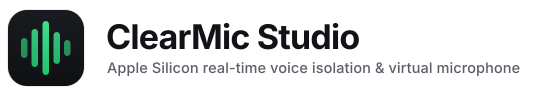

<p align="center">
  <picture>
    <source media="(prefers-color-scheme: dark)" srcset="assets/wordmark-dark.svg" />
    
  </picture>
</p>

<p align="center">
  
  
  
  
  <a href="LICENSE"></a>
</p>

**ClearMic Studio** is a native macOS application and bundled CoreAudio virtual microphone that isolates **only your enrolled voice** from background noise, busy cafés, room reverb, and nearby speakers (family, coworkers, TV) — in real time, **100% on-device**, at **~74–95 ms** end-to-end latency on Apple Silicon.

Instead of relying on cloud APIs or heavy PyTorch pipelines, ClearMic Studio runs custom **Metal shaders**, **Apple MLX**, **Apple Accelerate (`vDSP` / ARM64 NEON)**, and a native **CoreAudio HAL `AudioServerPlugIn`** (`ClearMic Virtual Mic`) that Zoom, Google Meet, Discord, and OBS select directly as a standard microphone — with **zero PyTorch at runtime** and **~266 MB** GPU memory.

---

## Highlights

- **Locks onto *your* voice:** Enrolls a 5-second voice print directly from your microphone — or by dragging & dropping an `.m4a`/`.wav` Voice Memo — and suppresses other people speaking in the same room via **STFT-fused multi-pass VoxLock** (1, 2, or 3 passes at a constant **24 ms** algorithmic delay).
- **Handles irregular real-world noise:** Runs **Inworld Realtime 48 kHz** denoising ahead of target-speaker extraction, removing clattering dishes, typing, street traffic, café chatter, and room reverb (`23.9 dB` irregular noise reduction, `0.993` clean-voice fidelity under `-2.5 dB` SNR stress tests).
- **Real 48 kHz voice highs, 0 ms extra delay:** Preserves your microphone's real `7.2–24 kHz` vocal air using a native C++ `vDSP_biquad` crossover gated causally by your target-to-total vocal envelope ratio — paired with a zero-latency **Broadcast Studio EQ** (warmth, boxy-mud cut, presence, air) and soft-knee leveler.
- **Guided Setup & Bundled Virtual Mic (`ClearMic.driver`):** No BlackHole, no Homebrew, no Terminal setup. On first launch, ClearMic Studio's native macOS setup assistant walks through Microphone permission, one-click Touch ID installation (and uninstall) of the signed CoreAudio HAL driver, and voice-print enrollment. macOS never hijacks your speakers (`DeviceCanBeDefaultDevice = 0` on output).
- **Built-in 5-second Sound Check:** Record 5 seconds of your live processed voice and hear it played straight back before joining a call.

---

## Architecture

```
  Any Mic (MacBook / AirPods / USB / XLR)
     │  CoreAudio AVAudioEngine + AVAudioConverter → 48 kHz mono float32 (20 ms chunks)
     ▼
  Unix Domain Socket  (/tmp/clearmic_audio_<pid>.sock)
     │
     ├─► Stage 1A · Inworld Realtime MLX (58.2M params, 48 kHz causal)
     │     BF16 backbone · Q8 decoder · Q8/Q4 two-tier KV cache
     │     Algebraic Mamba weight folding · float4 threadgroup-SRAM Metal scan · vDSP FFT
     │
     ├─► Stage 1B · VoxLock MLX (19.4M params, 16 kHz causal target-speaker lock)
     │     1024-thread char4 INT8 Metal LSTM · Q8 mask decoder
     │     STFT-fused 1/2/3-pass in one compiled GPU dispatch (constant 24 ms algo delay)
     │
     └─► Stage 2 · Native C++ Accelerate vDSP / ARM64 NEON (0.0 ms added latency)
           7.2 kHz Butterworth crossover · causal 2–7.2 kHz Wiener target-ratio highs gate
           0 ms Broadcast Studio EQ (80 Hz HPF · warmth · de-mud · presence · air) · limiter
     │
     ▼
  ClearMic.driver  (CoreAudio HAL AudioServerPlugIn · 48 kHz stereo loopback)
     │
     ▼
  Zoom · Google Meet · Discord · OBS · Audio Hijack  →  "ClearMic Virtual Mic"
```

*(Also includes [`engine/m5_hyper_pipeline.py`](engine/m5_hyper_pipeline.py) and [`engine/coreml_ane.mm`](engine/coreml_ane.mm) for offline / high-throughput 3-stage neural super-resolution running **Metal GPU ∥ Apple Neural Engine ∥ vDSP CPU** concurrently at up to **4.16× real time**.)*

---

## Live Modes & Apple M5 Benchmarks

### Real-Time Call Modes (`engine/low_latency_48k.py` & `ClearMic Studio.app`)

| Mode | Inworld Look-Ahead | VoxLock Passes | Algorithmic Delay | Total E2E Latency *(AC)* | GPU Memory | Best For |
|---|---:|---:|---:|---:|---:|---|
| **Studio call** *(default)* | `2` (20 ms) | `3` *(STFT-fused)* | `85 ms` | **`~95 ms`** | `~266 MB` | Strongest removal of other voices & café noise |
| **Low delay** | `0` (0 ms) | `2` *(STFT-fused)* | `65 ms` | **`~74 ms`** | `~266 MB` | Tightest delay with voice lock |
| **Natural** | `2` (20 ms) | `1` | `85 ms` | **`~95 ms`** | `~266 MB` | Lightest touch on your voice |
| **Noise removal** | `2` (20 ms) | — | `61 ms` | **`~62 ms`** | `~235 MB` | Removes noise, keeps every voice in the room |

### Component Speedups on Apple M5 (9.02 s Multi-Speaker Noisy Clip @ 48 kHz)

| Stage | Baseline | Optimized (Apple Silicon) | Speedup | GPU RAM |
|---|---:|---:|---:|---:|
| **Inworld Realtime 48 kHz** | `5.456 s` (PyTorch MPS FP32) | **`0.897 s`** (`10.1× RT`, MLX + Metal + vDSP) | **6.08×** | `196–329 MB` |
| **VoxLock Causal TSE 16 kHz** | `3.230 s` (ONNX CPU INT8) | **`0.561 s`** (`16.1× RT`, char4 INT8 Metal LSTM) | **5.76×** | `31 MB` |
| **MossFormer2_SR_48K** *(optional offline/AI)* | `3.039 s` (PyTorch MPS FP32) | **MLX BF16 `19.7 ms` ∥ GIL-free ANE HiFi-GAN** | **4.3×** | `110 MB` |
| **Full 3-Stage AI Pipeline** *(optional)* | `11.725 s` (`0.77× RT`) | **`2.171 s`** (`4.16× RT`, Metal ∥ ANE ∥ vDSP) | **5.40×** | `331 MB` |

---

## Quickstart

### Requirements
- **Apple Silicon Mac** (M1–M5) running **macOS 14+**
- **Xcode Command Line Tools** (`clang`, `swiftc`)
- **Python 3.11+** (`uv` recommended)

### 1. Install Python dependencies
```bash
uv venv
uv pip install -e .
```

*(Model weights for Inworld Voice Isolator and VoxLock download automatically on first launch from HuggingFace and cache locally.)*

### 2. Build & launch the macOS app
```bash
make run          # build, sign, and launch ClearMic Studio.app
make dmg          # optional: build signed drag-to-Applications dist/ClearMic-Studio.dmg
```

`make run` compiles `engine/libnative_dsp.dylib`, `engine/libcoreml_ane.dylib`, the bundled CoreAudio virtual mic (`ClearMic.driver`), and `ClearMic Studio.app`, auto-signing with your **Developer ID Application** certificate if present in Keychain (or ad-hoc signing otherwise).

### 3. First-time setup inside ClearMic Studio
1. **Allow microphone** — click **Allow microphone** in the Setup sheet (or open System Settings → Privacy & Security → Microphone directly from the app).
2. **Install virtual mic** — click **Install virtual mic**; macOS prompts once for your Touch ID / admin password, installs `ClearMic.driver` into `/Library/Audio/Plug-Ins/HAL/`, and reloads `coreaudiod`. (You can also uninstall it anytime from **Setup**.)
3. **Target voice print** — click **Record 5s** and speak naturally alone, or drag & drop an existing `.m4a` / `.wav` Voice Memo onto the card (saved to `~/Library/Application Support/ClearMic Studio/voice_print_16k.wav`).
4. Click **Start live mic**, test yourself with **Run sound check**, and choose **`ClearMic Virtual Mic`** as your microphone in Zoom, Google Meet, or Discord.

---

## Project Layout

```
clearmic-studio/
├── assets/                 # SVG icon and dark/light wordmarks
├── engine/
│   ├── inworld_mlx.py      # 48 kHz causal denoiser (MLX + float4 Metal Mamba scan + vDSP FFT)
│   ├── voxlock_mlx.py      # 16 kHz causal TSE (char4 INT8 Metal LSTM + STFT-fused 1/2/3-pass)
│   ├── low_latency_48k.py  # ~74–95 ms real-48k gated-highs + 0 ms broadcast EQ pipeline
│   ├── live_daemon.py      # Real-time Unix-socket PCM engine controlled by the macOS app
│   ├── native_dsp.cpp      # C++20 Apple Accelerate vDSP + ARM64 NEON DSP library
│   ├── restorer_mlx.py     # Optional MLX BF16 MossFormer2_SR_48K neural restoration
│   ├── m5_hyper_pipeline.py# Optional concurrent Metal GPU || CoreML ANE || CPU 3-stage runner
│   └── coreml_ane.mm       # GIL-free Objective-C++ CoreML Apple Neural Engine wrapper
└── macos_app/
    ├── build_app.sh        # Builds, bundles ClearMic.driver, generates .icns, Developer ID signs
    ├── build_dmg.sh        # Builds signed drag-to-Applications dist/ClearMic-Studio.dmg
    ├── entitlements.plist  # Hardened Runtime + Microphone + AppleEvents entitlements
    ├── Driver/             # Native C CoreAudio HAL AudioServerPlugIn ("ClearMic Virtual Mic")
    └── Sources/            # Native SwiftUI + CoreAudio macOS application (incl. SetupSheet)
```

---

## Acknowledgments & License

Built on top of open-weight audio models:
- **[Inworld Voice Isolator](https://github.com/inworld-ai/voice-isolator)** — 48 kHz causal denoiser weights
- **[VoxLock](https://github.com/voxlock/voxlock)** — 16 kHz causal target-speaker extraction weights
- **[ClearerVoice-Studio (`MossFormer2_SR_48K`)](https://github.com/modelscope/ClearerVoice-Studio)** — optional 48 kHz neural speech restoration weights

Released under the [MIT License](LICENSE).
